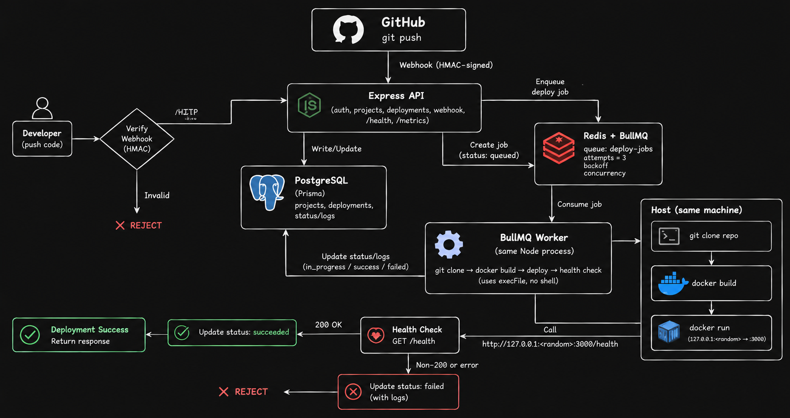

# MiniCloud

> A mini Heroku/Railway-style deployment platform — push to GitHub, get a
> running, health-checked Docker container.


Connect a GitHub repo to a project; a `git push` fires a webhook that runs an
asynchronous pipeline — clone the exact commit → install → test → build →
Docker image → isolated container → health check → **SUCCESS/ERROR** — with
per-stage logs, retries, timeouts, cleanup, rollback, and Prometheus metrics.

**🔗 Live demo:** https://app.3.110.222.63.sslip.io · login `demo@minicloud.local` / `password123`
_(demo box — may be offline to save cost.)_

**📚 Deep dives:** [System Design](./SYSTEM_DESIGN.md) · [Deployment guide](./DEPLOY.md) · [Frontend](https://github.com/sidharth-rawat/minicloud-frontend)

<!-- ## Demo
Record a ~60s clip (login → new deployment → DEPLOYING → green → logs), then
commit docs/demo.gif and uncomment this section:

-->

## Architecture



The API and the BullMQ worker run in **one Node process**; the worker shells out
to the host's `git` and `docker` CLIs. Full rationale and trade-offs are in
[SYSTEM_DESIGN.md](./SYSTEM_DESIGN.md).

## Tech stack

Express 5 · TypeScript (ESM) · PostgreSQL 16 + Prisma 7 · Redis 7 + BullMQ ·
JWT + bcrypt · Zod · Vitest + Supertest · prom-client · host `git` + `docker`.

## API

| Method | Path | Notes |
|--------|------|-------|
| POST | `/auth/register`, `/auth/login` | public |
| GET  | `/auth/me` | current user |
| CRUD | `/projects`, `/projects/:id` | ownership-enforced |
| POST/GET | `/projects/:id/deployments[...]` | create, list, get, **logs** |
| POST | `.../deployments/:id/retry` · `.../rollback` | re-run · new deploy at prior commit |
| POST | `/webhooks/github` | GitHub push (HMAC-verified) |
| GET  | `/health` · `/metrics` | liveness · Prometheus |

## Quick start (local)

```bash
docker compose up -d          # PostgreSQL + Redis
cp .env.example .env          # set JWT_SECRET_KEY, GITHUB_WEBHOOK_SECRET
npm install
npx prisma migrate deploy && npx prisma generate
npm run dev                   # API + worker on http://localhost:4000
npm test                      # Vitest (unit + integration)
```

Deployed apps must ship a root `Dockerfile`, listen on `DEPLOY_APP_PORT`
(default 3000) and serve `DEPLOY_HEALTH_PATH` (default `/health`). Only
`https://github.com/<owner>/<repo>` URLs are accepted (SSRF protection).

## Deploy to a server

See **[DEPLOY.md](./DEPLOY.md)** — one-command bootstrap on an Ubuntu EC2 box
with free HTTPS (Caddy + sslip.io, no domain needed).
